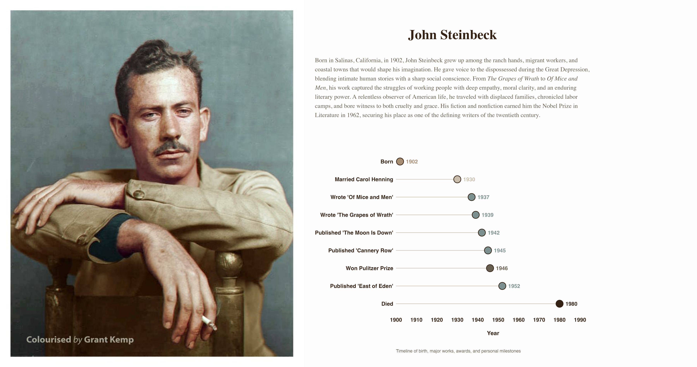

# John Steinbeck Timeline

This repository contains a visual and interactive timeline of the life and works of
John Steinbeck, generated from the data in `steinbeck_timeline.R`. The primary
output is a web‑ready SVG/HTML file that shows major life events and publications.

## How to Use

1. **Run the R script**: In an R console, execute `source("steinbeck_timeline.R")`.
   This will create a `timeline.html` file in the project root and a PNG snapshot
   named `steinbeck_final_hq.png`.
2. **View the timeline**: Open `timeline.html` in a browser to explore the
   interactive timeline.

## Repository Structure

```
├── README.md                 # This file
├── steinbeck_timeline.R      # R script to generate timeline
├── timeline.html              # Generated output (once script is run)
└── steinbeck_final_hq.png    # Snapshot of the timeline
```

### Example

Below is a snapshot of the generated timeline:



## License

This project is released under the MIT License.

